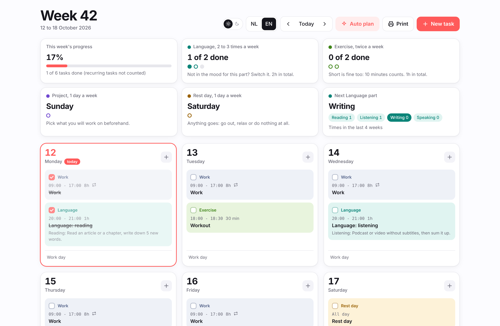
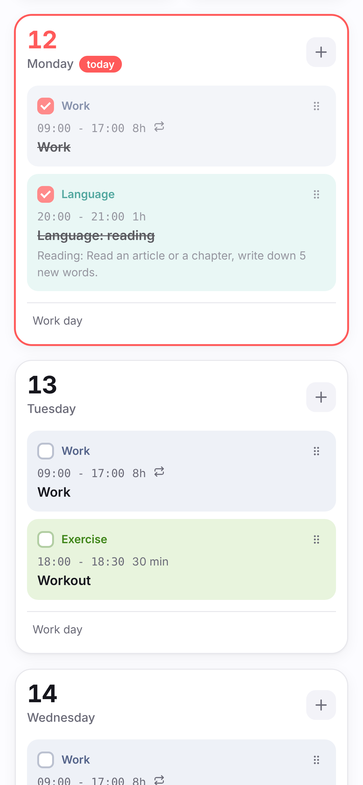

# Weekplanner

Free weekly planner that runs in your browser. Plan work, study, workouts and rest days, set weekly goals and let it fill your week. Drag and drop, recurring tasks and print to one A4 page. No account, no tracking, your data stays on your device.

### [Open Weekplanner](https://codershiyar.github.io/weekplanner/)

English version: [codershiyar.github.io/weekplanner/?lang=en](https://codershiyar.github.io/weekplanner/?lang=en)

<picture>
  <source media="(prefers-color-scheme: dark)" srcset="screenshots/desktop-dark.png">
  
</picture>

[Nederlands staat hieronder](#nederlands)

---

## What is it?

Weekplanner helps you plan your week in one clear overview. Add your work, study, workouts and free time, set a goal for each, and let the planner find a good spot for everything.

It works right away in your browser. There is nothing to install and no account to create. Your planning is saved on your own device, so nobody else can see it.

## Getting started

1. **Open the planner** with the link above. You will see an example week, so you can see how it works.
2. **Make it yours.** Click a category under *Categories* to change its name, color, weekly goal and preferred times. Add your own with *New category*.
3. **Clear the examples** with the button at the top when you are ready, or keep them and change them.
4. **Click Auto plan.** The planner fills your week based on your goals and preferred times.
5. **Check off tasks** as you go and watch your progress for the week.

Tip: add the page to your home screen or bookmarks, so it is always one tap away.

 

## What you can do

| Feature | What it does |
|---|---|
| Week overview | All seven days at a glance, on your phone or computer |
| Categories | Your own name, color, weekly goal and default length for each type of task |
| Auto plan | Places your weekly goals at your preferred days and times, spread over the week |
| Parts | Split a category into parts, like Reading, Listening, Writing and Speaking. The planner suggests the one you did least |
| Recurring tasks | Repeat a task every week, like work on Tuesday. Skip or move a single week when needed |
| Drag and drop | Move a task to another day with the grip handle, with your mouse or finger |
| Day notes | A short note under each day, like "Day off" or "Gym in the evening" |
| Your rules | A list of your own planning rules, with bold text where you want it |
| Print | Your whole week on one A4 page in landscape, with boxes to tick on paper |
| Backup | Download your planning as a file and restore it on another device |
| Light and dark mode | Switch with one tap, or let it follow your device |
| Two languages | Dutch and English, switch at the top of the page |

## Your privacy

- No account, no sign up, no email address.
- No tracking and no analytics.
- Your planning is stored only in your browser on your device. It is never sent anywhere.

Because your data lives in your browser, clearing your browsing data also removes your planning. Use **Download backup** now and then to keep a copy. With **Restore backup** you can move your planning to another phone, computer or browser.

## Questions

**Is it really free?**
Yes. There are no paid plans and no ads.

**Can I use it on my phone?**
Yes. The planner works in any modern browser on phone, tablet and computer.

**Does it work offline?**
Once the page is open, everything works without internet. Only the font is loaded online, and without it your system font is used.

**Can I use it on more than one device?**
Yes, but each device keeps its own planning. Download a backup on one device and restore it on the other.

**I found a bug or have an idea.**
Please open an [issue](https://github.com/codershiyar/weekplanner/issues). Feedback is welcome.

---

## Nederlands

Gratis en privé weekplanner in je browser. Stel weekdoelen in, laat je week slim inplannen en print hem. Geen account nodig.

### [Open Weekplanner](https://codershiyar.github.io/weekplanner/)

<picture>
  <source media="(prefers-color-scheme: dark)" srcset="screenshots/desktop-dark.png">
  
</picture>

### Wat is het?

Met Weekplanner plan je je week in één duidelijk overzicht. Zet je werk, studie, sport en vrije tijd erin, kies per onderdeel een doel, en laat de planner een goede plek voor alles vinden.

Het werkt meteen in je browser. Je hoeft niets te installeren en geen account te maken. Je planning wordt op je eigen apparaat bewaard, dus niemand anders kan hem zien.

### Zo begin je

1. **Open de planner** via de link hierboven. Je ziet eerst een voorbeeldweek, zodat je ziet hoe het werkt.
2. **Maak hem van jou.** Klik bij *Soorten* op een soort om de naam, kleur, het weekdoel en de voorkeurstijden aan te passen. Met *Nieuwe soort* voeg je er zelf een toe.
3. **Wis de voorbeelden** met de knop bovenaan als je klaar bent, of houd ze en pas ze aan.
4. **Klik op Slim inplannen.** De planner vult je week op basis van je doelen en voorkeurstijden.
5. **Vink taken af** en zie je voortgang van de week.

Tip: zet de pagina op je beginscherm of bij je favorieten, dan heb je hem altijd bij de hand.

### Wat kan het

- Weekoverzicht met alle zeven dagen, op telefoon en computer
- Soorten met een eigen naam, kleur, weekdoel en standaard duur
- Slim inplannen op je voorkeursdagen en tijden, verspreid over de week
- Onderdelen per soort, zoals Lezen, Luisteren, Schrijven en Spreken
- Herhalende taken, zoals werk op elke dinsdag
- Taken naar een andere dag slepen met het greepje
- Dagnotities en een lijst met je eigen regels
- Je week printen op één A4 liggend
- Back-up downloaden en terugzetten
- Lichte en donkere modus met één klik, in het Nederlands en Engels

### Je privacy

Geen account, geen tracking en geen statistieken. Je planning staat alleen in je browser op je eigen apparaat en wordt nergens naartoe gestuurd. Wis je je browsergegevens, dan is je planning weg. Maak daarom af en toe een back-up via **Back-up downloaden**.

### Vragen of ideeën?

Open een [issue](https://github.com/codershiyar/weekplanner/issues). Feedback is welkom.